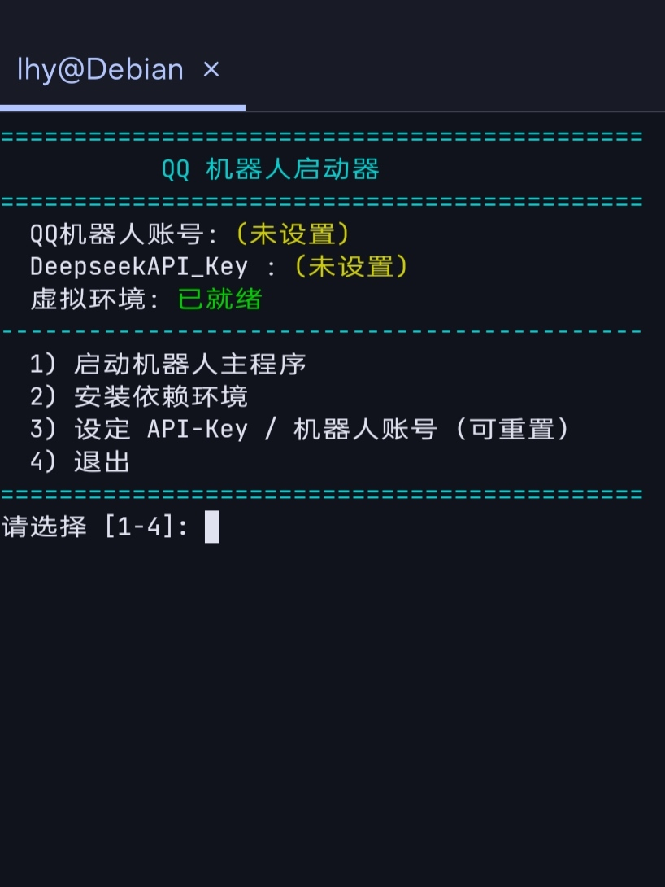
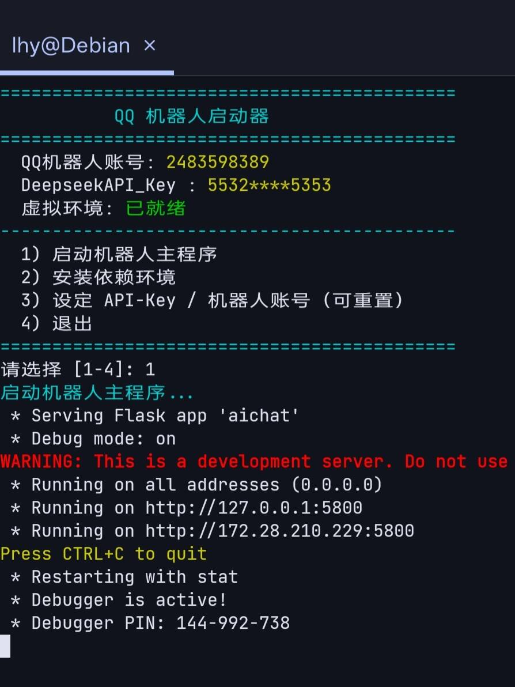

# 基于Flask框架，借助Napcat与Onebot11构建的QQ聊天机器人
onebot11项目地址:
https://github.com/botuniverse/onebot-11/tree/master

napcat项目地址:
https://github.com/NapNeko/NapCatQQ

napcat官方文档:
https://napneko.github.io/

### 简介：
这是一个名为“芒果”的智能聊天机器人后端服务。它基于 Python 的 Flask 框架搭建，通过HTTP协议与Napcat客户端通信，为用户在QQ群或私聊中提供AI（使用deepseek模型）对话、签到、转账、银行存取款、抽奖、点赞等一系列趣味互动功能。
### 最近更新：
1. 添加脚本```start.sh```，它提供了环境部署、参数设置、启动主程序的功能，减少了部署的复杂程度。
2. 更改联网搜索方式，现在是通过Deepseek提供的搜索接口搜索。搜索的信息更丰富、更准确。


### 使用示例：


图一是机器人给用户点名片赞，图二是机器人调用deepseek跟用户聊天，图三是机器人智能调用固定交互功能。

## 注意⚠️
除了固定交互功能，聊天与智能调用需要deepseek的api才能使用，在使用前请确保拥有key。

## 必看⭐
HTTP服务端（即收信息端）端口为：```5700```

HTTP客户端（即发信息端）端口为：```5800```

当然你可以在aichat.py文件中自行修改这些端口值


# 部署
请使用Debian/Ubuntu系统部署，推荐Debian12+，Ubuntu22.04+
安装依赖：
```
sudo apt update && sudo apt install git
```
克隆并进入本项目(当然你也可以直接下载本项目直接解压使用)：
```
git clone --depth=1 https://github.com/lhy660/QQbot.git && cd QQbot
```
运行预启动程序：
```
bash start.sh
```
### 终端画面：


初次使用先输入“2”回车确认，让程序为您部署运行环境。

结束后按“3”回车确认，然后依次输入机器人使用的QQ号、DeepseekAPI。



最后输入“1”回车确认，机器人后端程序即可运行。

## 按ctrl+c退出Flask机器人后端程序。


#  README.md文档还正在完善，敬请期待……
